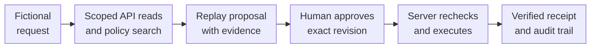
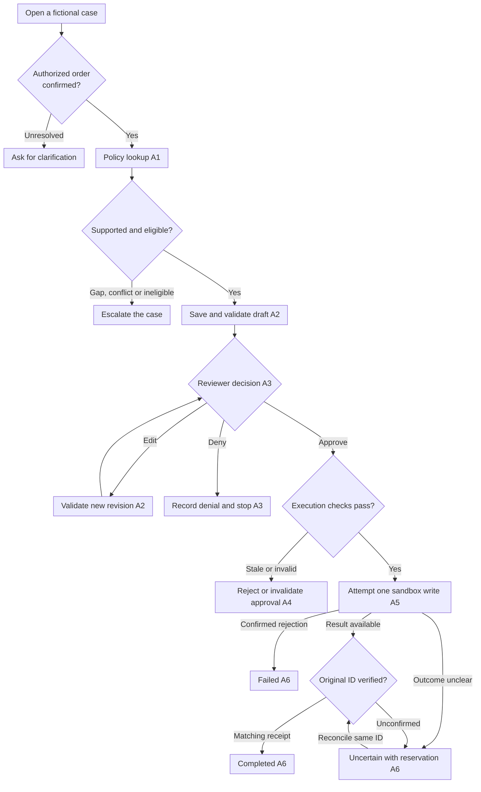

# CasePilot Stage 1 flows

Both diagrams describe the fictional sandbox. The hosted desk presents read-only replay. Reviewer decisions, retained audit records, and verified mock outcomes are available on the local desk.

## Request to verified outcome

A support representative opens a seeded request. Authorized order facts and applicable policy passages support the replay proposal. A reviewer approves one exact revision, the backend checks it again, and a matching readback produces a local receipt. The local audit trail connects the evidence lookup, reviewer decision, and verified outcome.

### Overview talk track · about 60 seconds

> CasePilot is a support desk for fictional board-game orders. I specified how a representative should investigate a case and used Codex to build the workflow. When I open a case, the server checks which order this session can see and retrieves the applicable policy passages. The desk shows the facts, excerpts, and proposed action together. Stage 1 uses deterministic replay, so the same seeded case produces a repeatable result with zero model calls. The review panel binds a person's approval to the exact revision they saw. A separate backend executor checks that approval and the current facts before recording a sandbox action. The receipt appears only after the executor reads back the matching record. The audit helps me explain which facts, policy versions, and decisions led to the outcome.

## Decisions and failures

Missing information prompts clarification. Missing or conflicting evidence or failed eligibility sends the case for review. Denial records the decision and ends the attempt. Edits require a fresh revision and approval, including the intentionally invalid SC04 draft. Once approved, a separate execution request must pass the server's checks. A confirmed rejection ends that attempt as failed. An uncertain result keeps the original operation and reservation available for reconciliation.

| Marker | Audit evidence | Scenario and acceptance IDs |
| --- | --- | --- |
| A1 | Authorized lookups, policy versions, tool outcomes, and eligibility basis in a saved investigation. Use **Save investigation to audit** to retain a run without a proposal. | SC05 / AT05a–c, SC06 / AT06, SC07 / AT07a–c, SC10 / AT10a, SC14 / AT14, SC15 / AT15, SC18 / AT18b |
| A2 | Validation outcome and saved proposal or edited revision | SC01 / AT01, SC02 / AT02a–c, SC04 / AT04, SC09 / AT09, SC11 / AT11a |
| A3 | Approval or denial with reviewer and revision | SC01 / AT01, SC03 / AT03, SC04 / AT04 |
| A4 | Rejected or invalidated approval when current checks fail | SC08 / AT08a–b, SC17 / AT17, SC18 / AT18c |
| A5 | Execution attempt, original operation ID, and idempotency fingerprint | SC12 / AT12a–c, SC13 / AT13a–c |
| A6 | Verified receipt, confirmed failure, or uncertainty. Reconciliation follows the same operation ID. | SC11 / AT11b, SC13 / AT13a–c, SC17 / AT17, SC18 / AT18a |

### Failure walkthrough · about 90 seconds

> I use SC13 to show why an uncertain result needs its own state. This is the fictional $76 return for order O113. I prepare the proposal, check its policy links, and approve the saved revision as the local reviewer. That approval lets the executor consider this particular action. It still checks the current facts and balance before writing. I select **Timeout after commit** and execute. In this fixture the ledger write has committed, but the first response leaves the result uncertain. The screen shows the operation ID and the reservation. There is no verified receipt at this point. I use **Reconcile operation** to ask the backend to read back that same ID. CasePilot compares the persisted entry with the approved action. When those facts match, the same operation moves to completed and the desk shows its $76 sandbox receipt. Refreshing shows the same record. The audit connects the review decision, execution attempt, uncertain status, and verified result. A confirmed rejection leaves the case failed, and a result that remains unresolved stays reserved until reconciliation can verify it.

## Documentation acceptance checklist

- [x] Editable Mermaid overview and decision flow include the review boundary and separate execution outcomes.
- [x] Both diagrams have captions and spoken talk tracks. The failure walkthrough uses SC13 / AT13b.
- [x] The decision legend maps evidence, validation, reviewer decision, invalidation, attempt, and outcome to the scenario evaluation.
- [x] Parse and render both diagrams locally. Mermaid 12.3.0 parsed both flowcharts in Edge. Render inspection checked every node label, arrow routing, clipping, and branch placement.
- [ ] Confirm GitHub rendering on the published revision during the release review.

[Stage 1 specification and five-minute walkthrough](STAGE1.md) · [Scenario evaluation](EVALUATION.md)
