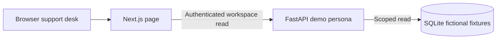
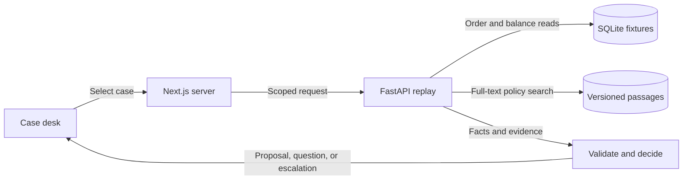

# CasePilot build progress

Update this file after each working slice. Record the demonstrated scope, checks actually run, limitations and the decision for the next checkpoint. Git history tracks the source for each slice.

## 2026-11-18 · Planning approved

- Confirmed `E:\casepilot` as the project folder. Existing planning and personal materials stay outside Git.
- Chose a Next.js and React frontend, FastAPI backend and SQLite for the resettable local sandbox.
- Agreed to commit verified slices and push them privately. Public source publication follows the Stage 1 acceptance and publication review.

## 2026-11-18 · Checkpoint 1, fixture-driven support desk

The browser opens a seeded case. Next.js reads the fixture workspace from FastAPI using a server-side demo token. FastAPI serves only C100's scoped cases from SQLite. The screen displays prewritten policy links, a proposal preview and sample run history.

### Rules shown

- **SC01** shows O100 v3, the received unused return and a proposed $80.00 refund with KB01 and KB04 v1. Viewing it leaves the ledger empty.
- **SC05** shows a request that needs an order ID. The screen pauses with no selected order or proposal.
- **SC18** shows an order eight days past its promised date and unknown shipment status. The fixture shows no delivery estimate or replacement proposal.
- The workspace API uses the server's customer scope. All five demo policy records and four base orders are in the versioned `stage1-v1` fixture.

### Verification

- **Passing** · Four backend tests cover SC01, SC05, SC06 and SC18 fixture behavior, including a zero-row ledger after repeated reads and exclusion of C200 records. These checks cover the fixture-view portions of those scenarios.
- **Passing** · `npm run build` compiled the Next.js page and checked TypeScript.
- **Passing** · Edge smoke check loaded the real local workspace, followed a citation and opened a case by keyboard, checked the late shipment, and found no horizontal overflow at 390 pixels or runtime page errors. Reviewed desktop and mobile screenshots.
- Full Stage 1 acceptance testing is pending. In particular, AT01 still requires an approved and verified execution.

### Known limitations and next decision

The evidence, proposal and run history are predefined. The only API in use is the scoped workspace read. Model calls, policy search, reviewer controls, execution, real audit events and acceptance variants are scheduled for later checkpoints.

Next decision after review: approve Checkpoint 2 with free deterministic replay so its evidence and missing-information paths can be checked without a model account.

## 2026-11-18 · Vercel compatibility and GitHub push workflow

- Added Vercel Services (Beta) configuration for Next.js and FastAPI in one project. Public routing reaches the frontend. A private binding carries the token-authenticated workspace read to the packaged Python service.
- The hosted checkpoint serves a read-only snapshot seeded on startup from the same fictional records. The local demo uses a resettable SQLite file. Hosted writes and reconciled receipts require shared durable storage and a separate review.
- Added the required pre-push script and recorded GitHub as the deployment trigger in `AGENTS.md`.
- **Passing** · Five backend tests and the Next.js production build. The hosted-entry test checks the packaged seed, bearer authentication, and rejection of writes.
- **Passing** · `vercel dev --local` loaded SC01 and its $80 proposal through the service binding. A request through the frontend URL to `/demo/workspace` returned 404.
- **Pending** · Vercel account inspection found no project connected to the GitHub repository. `vercel build` reported that linked project settings were required. The Git-triggered cloud build is pending that connection. See the [README](../README.md#github-and-vercel) for the Services preset and protection settings.

## 2026-11-18 · First Vercel production deployment

- The first deployment built Next.js and FastAPI successfully. An authenticated request showed **Case desk unavailable** because the production demo token was missing.
- Enabled Vercel Authentication for all deployments. Confirmed the production address required sign-in before adding `CASEPILOT_DEMO_TOKEN` as a production-only Vercel Secret.
- Five backend tests and the Next.js production build passed before push. Local `vercel build --prod` compiled Next.js and hit a Windows symlink permission error during packaging. Vercel's first cloud build packaged both services successfully.
- A fresh GitHub-triggered build picks up the secret. Check the deployed page for the SC01 fixture and its $80 proposal after Vercel reports Ready.

## 2026-11-18 · Repository privacy

- Checked the three existing commits and confirmed GitHub had only the matching `main` branch. The review found no personal documents, ZIP archives, or matches for local secrets and common credential formats.
- Added repository-wide ignore rules for Word and PDF documents, ZIP archives, and common private-key files. Recorded the pre-push review and stop rule in `AGENTS.md`.

## 2026-11-18 · Checkpoint 2, direct reads and deterministic replay

Opening a case now runs an investigation against `stage1-v2` instead of displaying canned evidence and proposals. Existing installations need one fixture reset. The source repository is public by the product owner's request. Vercel Authentication protects the hosted desk.

In **SC01**, the server uses the demo session to find O100 v3, retrieves KB01 and KB04, and checks that the unused return was received within 30 days. The refund read finds 8,000 cents available. Replay validates the amount and citation versions and returns a proposal for review. The ledger stays empty.

### Rules and verification

| Scenario | Checkpoint 2 behavior verified |
| --- | --- |
| SC01, SC02 | Repeatable $80 proposal with versioned citations, inclusive day 30, rejection of day 31, future and malformed dates |
| SC05, SC06 | Clarification for a missing order ID and generic errors for orders outside the session's scope |
| SC07 | Missing, conflicting and expired evidence trigger escalation |
| SC09, SC11 | $20 remaining on the balance variant and rejection of malformed proposals |
| SC10, SC18 | One retry after a read timeout and a delay draft without an invented delivery date |

- **Passing** · Eleven backend tests and the Next.js production build. This covers the read and replay portion of the listed scenarios. Full Stage 1 acceptance remains pending.
- **Passing** · Edge opened the built app, navigated cases and citations by keyboard, and checked the refund, missing-order, missing and conflicting evidence, line balance, and delay paths. The page fit at 390 pixels and reported no runtime page errors.
- **Host limitation** · Local `vercel build --prod` compiled Next.js, then Windows refused a symlink during Vercel packaging.
- Replay uses seeded intent, up to six read attempts, one retry per timed-out read, a two-second read timeout, a 20-second run limit, and a 4,000-character request cap. The run history shows observed tool outcomes. It is regenerated for each view and makes zero model-provider calls.

### Review

Open SC01 and follow KB01 v1 from the $80 proposal. Open SC05 and check the order ID prompt. Compare the missing and conflicting SC07 cases. Review the unknown-status draft in SC18.

This slice serves read-only proposals and drafts. The next decision is whether to approve Checkpoint 3 for exact-revision reviewer controls and local sandbox execution.
